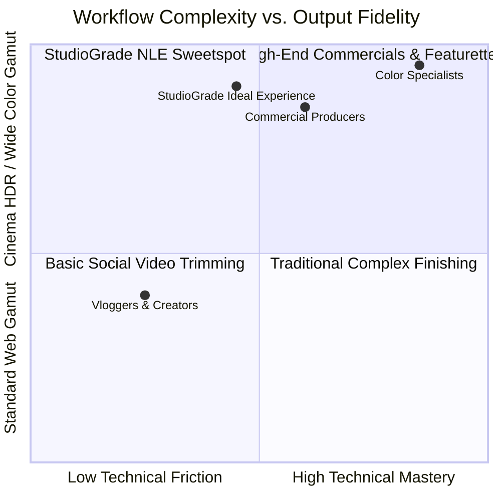
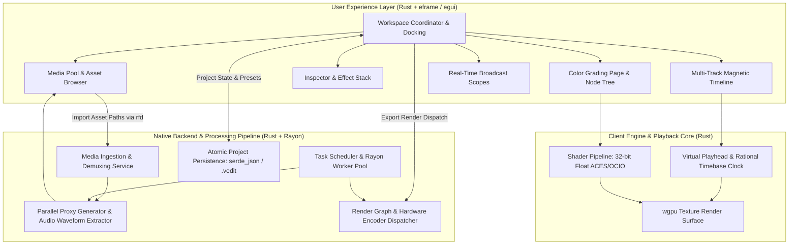

# 01. System Overview

## 1. Vision & Purpose

The **StudioGrade NLE** platform bridges the gap between two traditionally divergent worlds in digital video post-production:

1. **Intuitive Creator-First Workflows**: Fast, approachable multi-track editing with instantaneous drag-and-drop mechanics, rich preset libraries (animated titles, stickers, motion transitions, speed ramps), and intelligent automated tooling (auto-beat sync, silence removal).
2. **Hollywood-Grade Color Science**: Strict 32-bit floating-point precision, mathematically robust color transformation matrices, wide-gamut ACEScc/ACEScct workflows, node-based non-destructive grade graphs, and real-time GPU-accelerated broadcast analysis scopes.

Historically, creators were forced to choose between an accessible editor that lacked professional color science, or an intricate post-production suite with an intimidating learning curve. StudioGrade NLE unifies both experiences into a modular, modern workspace built entirely in **Rust** for maximum speed, memory safety, and sub-frame precision.

---

## 2. Target Personas & Use Cases

### Persona A: The High-Velocity Digital Creator
- **Needs**: Rapid assembly, magnetic snapping, pre-styled lower-thirds, instant transitions, subtitle generation, and direct exports formatted for modern streaming and social video.
- **Pain Point**: Professional color tools are overwhelming and slow down publishing schedules.
- **StudioGrade Solution**: 1-click creative LUTs, smart auto-balance, intuitive primary balance dials, and instant ripple editing.

### Persona B: The Commercial & Indie Filmmaker
- **Needs**: Ingestion of Log/RAW camera profiles (Sony S-Log3, Canon Log 2/3, ARRI LogC3/LogC4, RED IPP2, Panasonic V-Log), precise shot-matching, skin tone protection, ACES color management, and HDR delivery (Rec.2100 PQ/HLG).
- **Pain Point**: Simplified timeline apps clip out-of-gamut highlights and destroy shadow gradients during 8-bit conversions.
- **StudioGrade Solution**: 32-bit unclipped float processing, node-based grading tree, HDR zone wheels, 3D LUT cube interpolation, and calibrated broadcast scopes.

---

## 3. High-Level System Architecture

StudioGrade NLE operates on a unified, high-performance native Rust architecture that binds an immediate-mode UI with a multithreaded processing and rendering backend:

---

## 4. Key Functional Capabilities

### 4.1 Timeline & Story Assembly
- **Magnetic & Non-Magnetic Modes**: Auto-ripple trimming, gap closure, slip/slide editing, and razor cutting down to single audio samples.
- **Multi-Track Stacking**: Unlimited video, title, audio, and adjustment layer tracks with blend modes (Multiply, Screen, Overlay, Soft Light, Add).
- **Animation & Keyframing**: Intuitive keyframe diamonds on timeline clips with interactive Bézier curve speed ramp adjustments.
- **Built-in Asset Ecosystem**: Integrated motion titles, transitions (Zoom, Glitch, Dissolve, Whip Pan), overlays, sound effects, and royalty-free music tags.

### 4.2 Studio Color Grading Engine
- **Full 32-Bit Floating Point Pipeline**: Computations maintain sub-black and super-white values throughout the chain without intermediate clipping.
- **Color Wheels**:
  - *Primary Wheels*: Lift, Gamma, Gain, Offset with individual RGB color rings and master luminance wheels.
  - *Log Wheels*: Shadow, Midtone, Highlight with customizable low-range and high-range crossover points.
  - *HDR Zone Wheels*: Black, Dark, Shadow, Light, Highlight, Specular wheels for precise dynamic range sculpting.
- **Curves Matrix**:
  - Custom Bézier Spline (YRGB linked or unlinked).
  - Hue vs. Hue, Hue vs. Saturation, Hue vs. Luminance, Luminance vs. Saturation, Saturation vs. Saturation.
- **Node-Based DAG Color Architecture**: Serial nodes, Parallel splitter/combiner nodes, Layer blend nodes with qualifier masks (HSL, 3D Keyer, Power Windows).
- **GPU-Accelerated Broadcast Scopes**:
  - RGB Parade (10-bit and 12-bit graticule).
  - Waveform (YCbCr and Luma).
  - Vectorscope with calibrated 75% and 100% skin tone indicator line.
  - Histogram and False Color exposure overlay.

### 4.3 Audio Engineering
- Sub-frame audio alignment, volume automation rubber-banding, parametric 6-band EQ, noise suppression, and EBU R128 (-14 LUFS / -23 LUFS) loudness normalization.

### 4.4 Rendering & Export
- Hardware acceleration (NVIDIA NVENC, Intel QuickSync, Apple VideoToolbox, AMD AMF).
- Accurate color space tagging: Rec.709 Gamma 2.4, DCI-P3 D65, BT.2020 PQ/HLG HDR10.
- Presets for popular streaming platforms, cinema master ProRes 422 HQ / 4444, and Avid DNxHR.

---

## 5. Non-Functional Requirements (NFRs)

| Dimension | Specification | Verification Strategy |
| :--- | :--- | :--- |
| **UI Responsiveness** | 60–144 FPS under intensive timeline scrubbing and zoom. | Immediate-mode `egui` rendering over `wgpu` with zero DOM or garbage collection overhead. |
| **Playback Latency** | Under 15ms scrub latency for 4K ProRes/H.265 proxy streams. | Native multithreaded frame decoders + Ring-buffered memory caching. |
| **Color Precision** | IEEE 754 32-bit single-precision floating-point ($>16$ stops of dynamic range). | Automated shader mathematical unit tests against reference color charts in Rust test suite. |
| **Project Durability** | Zero data loss; state delta serialized via atomic file writes. | `serde_json` serialization to temporary files with atomic rename; recovery journal. |
| **Design Consistency** | 100% adherence to studio neutral dark tokens. | Custom `egui::Style` and `egui::Visuals` dark palette tokens for accurate color grading. |
