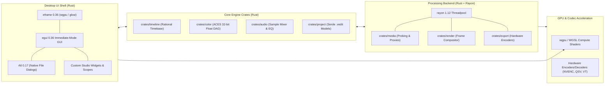
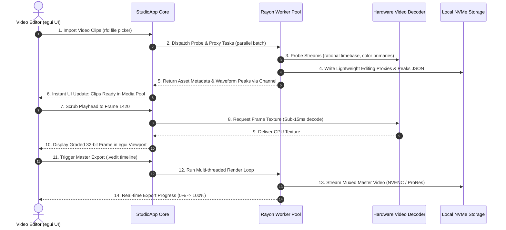

# 02. Architecture & Technology Stack

## 1. Technological Stack Overview

StudioGrade NLE is engineered as a unified, high-performance **native Rust application**. By relying on Rust across both the user interface and the processing backend, the platform eliminates foreign-function boundary penalties, avoids garbage collection pauses, and delivers deterministic sub-millisecond timeline interactivity and 32-bit floating-point color accuracy.



---

## 2. Cargo Workspace & Crate Architecture

The codebase is organized into an idiomatic Rust workspace designed for strict modularity, fast compilation, and independent testability:

```
myvideo-editor/
├── Cargo.toml                      # Workspace manifest
├── apps/
│   └── desktop/                    # Native application binary
│       ├── Cargo.toml
│       └── src/
│           ├── main.rs             # eframe entrypoint & event loop
│           ├── app.rs              # Root StudioApp state & frame update
│           ├── panels/             # egui panel layouts
│           │   ├── timeline_panel.rs
│           │   ├── color_panel.rs
│           │   ├── preview_panel.rs
│           │   ├── inspector_panel.rs
│           │   └── media_pool_panel.rs
│           ├── widgets/            # Custom egui widgets
│           │   ├── color_wheel.rs  # Lift/Gamma/Gain 2D chromaticity dial
│           │   ├── hdr_zones.rs    # HDR 6-zone dynamic range dial
│           │   ├── curve_editor.rs # Cubic Hermite spline curve widget
│           │   ├── timeline_ruler.rs
│           │   └── scopes.rs       # Parade, Vectorscope & Waveform painters
│           └── theme.rs            # Studio dark palette & egui styling
├── crates/
│   ├── timeline/                   # Deterministic timeline logic
│   │   ├── src/
│   │   │   ├── timebase.rs         # RationalTime (frames / timebase)
│   │   │   ├── track.rs            # Video, Audio, Title track definitions
│   │   │   ├── clip.rs             # Clip instances, in/out points, speed
│   │   │   ├── snapping.rs         # Magnetic interval snapping engine
│   │   │   └── history.rs          # Undo/Redo transaction stack
│   ├── color/                      # Hollywood-grade color engine
│   │   ├── src/
│   │   │   ├── math.rs             # 32-bit float matrix transforms & CDL
│   │   │   ├── aces.rs             # ACEScc, ACEScct, ACEScg IDT/ODT
│   │   │   ├── lut.rs              # .cube 3D LUT parser & tetrahedral math
│   │   │   ├── node_graph.rs       # Directed Acyclic Graph (DAG) grade tree
│   │   │   └── qualifier.rs        # HSL qualifier & Power Window math
│   ├── render/                     # GPU & CPU composition engine
│   │   ├── src/
│   │   │   ├── compositor.rs       # Layer blending & transition evaluation
│   │   │   ├── wgpu_pipeline.rs    # WGSL compute shaders for color & FX
│   │   │   └── frame_buffer.rs     # 32-bit float RGBA frame buffer pool
│   ├── media/                      # Asset ingestion & decoding
│   │   ├── src/
│   │   │   ├── probe.rs            # Stream probing & color metadata
│   │   │   ├── decoder.rs          # Multi-stream frame decoder
│   │   │   ├── proxy.rs            # Rayon-parallel proxy generator
│   │   │   └── waveform.rs         # Audio peak extraction
│   ├── audio/                      # Sample-accurate audio engine
│   │   ├── src/
│   │   │   ├── mixer.rs            # Multi-channel audio summing
│   │   │   ├── eq.rs               # Parametric 6-band biquad filter
│   │   │   └── loudnorm.rs         # EBU R128 / ITU-R BS.1770-4 meter
│   ├── export/                     # Output encoding & container muxing
│   │   ├── src/
│   │   │   ├── pipeline.rs         # Multi-pass export render loop
│   │   │   ├── hardware.rs         # NVENC, QuickSync, VideoToolbox binding
│   │   │   └── metadata.rs         # NCLX & HDR10 static metadata injector
│   └── project/                    # Project model & persistence
│       ├── src/
│       │   ├── schema.rs           # Project, Track, Clip serde structs
│       │   └── io.rs               # Atomic file persistence (.vedit)
├── assets/                         # Icons, default LUTs, test media
└── xtask/                          # Custom build automation & packaging
```

---

## 3. Frontend Architecture: `eframe` & `egui`

### 3.1 Immediate-Mode Execution Model
Unlike retained-mode DOM frameworks, `egui` uses an immediate-mode paradigm: the entire user interface is constructed dynamically on every frame. This eliminates state synchronization bugs, simplifies dynamic timeline rendering, and guarantees ultra-low memory footprint:

```rust
// apps/desktop/src/app.rs
use eframe::egui;

pub struct StudioApp {
    project: project::Project,
    timeline_state: timeline::TimelineState,
    color_state: color::ColorGradeState,
    active_tab: WorkspaceTab,
    media_pool: media::MediaPool,
}

impl eframe::App for StudioApp {
    fn update(&mut self, ctx: &egui::Context, _frame: &mut eframe::Frame) {
        // Render top menu & transport bar
        self.render_header_bar(ctx);

        // Center preview canvas & dockable panels
        egui::TopBottomPanel::bottom("timeline_panel")
            .resizable(true)
            .min_height(220.0)
            .show(ctx, |ui| {
                self.render_timeline(ui);
            });

        egui::SidePanel::right("inspector_panel")
            .resizable(true)
            .min_width(280.0)
            .show(ctx, |ui| {
                self.render_inspector(ui);
            });

        egui::CentralPanel::default().show(ctx, |ui| {
            self.render_viewport_and_scopes(ui);
        });
    }
}
```

### 3.2 High-DPI & GPU Rendering Backend
- **wgpu Backend**: Renders the UI and the video viewport directly through native graphics APIs (Vulkan on Linux/Android, Metal on macOS, DirectX 12 on Windows).
- **Zero-Copy Frame Surface**: Graded 32-bit floating-point video frames are held in GPU memory buffers and displayed in the egui viewport via `egui::TextureId` without round-tripping through host RAM.
- **Native File Dialogs**: Integrated with `rfd` (Rust File Dialog) for asynchronous, non-blocking native OS open/save dialogs on Linux, macOS, and Windows.

---

## 4. Backend Processing Engine: Rayon & Concurrency

The backend engine handles compute-intensive video and audio workloads using Rust's fearless concurrency patterns:



### 4.1 Rayon Multithreaded Worker Pool
- **Parallel Proxy Transcoding**: Encodes multiple lower-resolution ProRes Proxy or H.264 intra-frame clips across available CPU cores.
- **Audio Waveform Peak Generation**: Processes multi-gigabyte audio tracks in parallel chunks to generate peak min/max decibel buckets for instant visualization.
- **CPU Fallback Color Transforms**: For headless or non-GPU environments, 32-bit float color transformations and 3D LUT tetrahedral lookups are parallelized across pixel rows via `rayon::prelude::*`.

### 4.2 Inter-Thread Communication & Channel Architecture
- **Non-blocking Channels (`crossbeam-channel` / `std::sync::mpsc`)**: The UI thread sends commands (scrub, import, render) to worker threads without ever stalling the rendering loop.
- **Atomic Progress Trackers**: Render progress, frame cache statuses, and export percentages use `std::sync::atomic::AtomicU64` and `AtomicBool` for zero-overhead lock-free polling by the UI.

---

## 5. Communication & Data Serialization Protocols

### 5.1 Project Schema Definition (`.vedit` JSON)
All timeline cuts, effects, transition parameters, and color grading nodes are serialized into an explicit, deterministic JSON format using `serde` and `serde_json`:

```rust
// crates/project/src/schema.rs
use serde::{Deserialize, Serialize};

#[derive(Debug, Clone, Serialize, Deserialize)]
pub struct Project {
    pub version: String,
    pub meta: ProjectMeta,
    pub tracks: Vec<Track>,
}

#[derive(Debug, Clone, Serialize, Deserialize)]
pub struct ProjectMeta {
    pub title: String,
    pub timebase_numerator: u32,
    pub timebase_denominator: u32,
    pub width: u32,
    pub height: u32,
    pub working_color_space: String,
}

#[derive(Debug, Clone, Serialize, Deserialize)]
pub struct Track {
    pub id: String,
    pub track_type: TrackType,
    pub name: String,
    pub locked: bool,
    pub muted: bool,
    pub clips: Vec<Clip>,
}

#[derive(Debug, Clone, Serialize, Deserialize)]
pub struct Clip {
    pub id: String,
    pub asset_path: String,
    pub timeline_in: i64,
    pub timeline_out: i64,
    pub source_in: i64,
    pub source_out: i64,
    pub speed_multiplier: f64,
    pub color_grade: ColorGradeConfig,
}
```

```json
{
  "version": "1.0.0",
  "meta": {
    "title": "Documentary Feature - Episode 1",
    "timebase_numerator": 24000,
    "timebase_denominator": 1001,
    "width": 3840,
    "height": 2160,
    "working_color_space": "ACEScct"
  },
  "tracks": [
    {
      "id": "v-track-1",
      "track_type": "Video",
      "name": "Main B-Roll",
      "locked": false,
      "muted": false,
      "clips": [
        {
          "id": "clip-901",
          "asset_path": "/media/ocean_4k.mov",
          "timeline_in": 0,
          "timeline_out": 120,
          "source_in": 48,
          "source_out": 168,
          "speed_multiplier": 1.0,
          "color_grade": {
            "active_lut": "film_stock_5219.cube",
            "lut_intensity": 0.85
          }
        }
      ]
    }
  ]
}
```

---

## 6. Security, Resilience & Memory Safety Patterns

1. **Memory Safety & Zero Undefined Behavior**: The entire codebase compiles under `#![deny(unsafe_code)]` wherever possible. Memory safety guarantees eliminate buffer overflows, use-after-free bugs, and data races.
2. **Deterministic Timebase Calculations**: All timestamps are evaluated using `RationalTime { frames: i64, timebase: Rational }` to completely eliminate floating-point drift over multi-hour projects.
3. **Atomic File Persistence**: Project saves are written to a `.tmp` sibling file and atomically renamed (`std::fs::rename`) to ensure project files are never corrupted even during abrupt system power loss.
4. **Exhaustive Error Handling**: All operational failures are strictly modeled via `thiserror`, avoiding panics and providing detailed diagnostic logs to the user.
