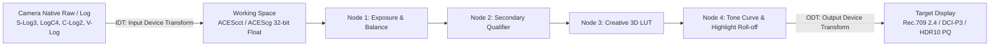
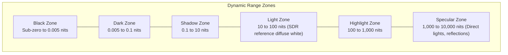
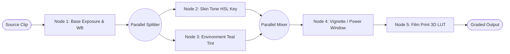

# 03. Precision Color Grading Engine

## 1. Mathematical Foundations & Color Science

StudioGrade NLE features a non-destructive, studio-grade 32-bit floating-point color science engine designed to preserve every photon captured by modern cinema sensors. Standard video editors clamp pixel data between $[0.0, 1.0]$ (8-bit $[0, 255]$ or 10-bit $[0, 1023]$), permanently destroying sub-black detail and blowing out specular highlights when contrast or exposure adjustments are performed.

In contrast, our color engine operates in **unbounded IEEE 754 32-bit floating point space ($-\infty$ to $+\infty$)**, maintaining linear radiance and $>16$ stops of dynamic range throughout all intermediate operations.



---

## 2. Color Management & ACES Pipeline

The platform natively supports the **Academy Color Encoding System (ACES 1.3)** and **OpenColorIO (OCIO)** architecture implemented in native Rust.

### 2.1 Color Spaces in the Pipeline
1. **ACES2065-1 (AP0)**: Ultra-wide archiving standard containing all human-visible chromaticity (CIE 1931).
2. **ACEScg (AP1)**: Linear color space tailored for computer graphics and compositing operations.
3. **ACEScc / ACEScct (AP1)**: Quasi-logarithmic encoding designed for colorists. ACEScct features an added "toe" curve in the shadows to provide familiar, tactile response during Lift/Shadow adjustments.

### 2.2 Input Transforms (IDTs)
The engine includes mathematical transformation matrices and transfer curve decoders for leading digital cinema formats:
- **Sony S-Log3 / S-Gamut3.Cine**
- **ARRI LogC3 & LogC4 / Wide Gamut 4**
- **Canon Log 2 & Log 3 / Cinema Gamut**
- **RED IPP2 / Log3G10 / REDWideGamutRGB**
- **Panasonic V-Log / V-Gamut**
- **Apple Log / BT.2020**
- **DJI D-Log / D-Gamut**

---

## 3. Primary Color Wheels: Mathematics & Implementations

### 3.1 Primary Lift / Gamma / Gain / Offset (CDL-Inspired Formula)

Let $C_{in} = (R, G, B)$ be the linear or ACEScct input color.

$$\begin{aligned}
\text{Lift Adjustment:} \quad & C' = C_{in} + \text{Lift} \times (1.0 - C_{in}) \\
\text{Gain Adjustment:} \quad & C'' = C' \times \text{Gain} \\
\text{Gamma Adjustment:} \quad & C_{out} = (C'')^{\frac{1.0}{\text{Gamma}}} \\
\text{Offset Adjustment:} \quad & C_{final} = C_{out} + \text{Offset}
\end{aligned}$$

Where:
- $\text{Lift} \in [-1.0, 1.0]$, default $(0, 0, 0)$. Controls shadow pedestal.
- $\text{Gamma} \in [0.1, 4.0]$, default $(1, 1, 1)$. Controls midtone density without shifting black/white points.
- $\text{Gain} \in [0.0, 4.0]$, default $(1, 1, 1)$. Multiplicative highlight adjustment.
- $\text{Offset} \in [-1.0, 1.0]$, default $(0, 0, 0)$. Uniform additive exposure shift across the entire dynamic range.

### 3.2 Log Wheels Architecture
For nuanced cinematic exposure balancing, the Log Wheels divide luminance into three discrete zones governed by user-definable crossover frequencies:
- **Shadow**: Modulates tones below `Low Range` threshold ($default = 0.333$).
- **Midtone**: Smoothly modulates intermediate values.
- **Highlight**: Modulates tones above `High Range` threshold ($default = 0.666$).

---

## 4. HDR Zone Wheels

For mastering High Dynamic Range (HDR10, Dolby Vision PQ, HLG), the engine provides six dedicated dynamic range zone wheels with custom Gaussian bell and sigmoid falloff envelopes:



Each zone allows independent saturation, hue tinting, exposure stops ($\pm 8\ \text{EV}$), and falloff smoothness tuning.

---

## 5. Comprehensive Curves Matrix

All curves operate on monotonic cubic Hermite splines or Catmull-Rom splines for zero derivative discontinuity:

1. **Custom YRGB Curve**: Independent control over Luma ($Y$), Red, Green, and Blue curves.
2. **Hue vs. Hue**: Rotate isolated hues (e.g., selectively shift yellow greens toward deep forest emerald).
3. **Hue vs. Saturation**: Boost or desaturate specific tones (e.g., saturate sky blues while desaturating neon distractions).
4. **Hue vs. Luminance**: Lighten or darken specific color bands (e.g., brighten skin tones without touching surrounding backgrounds).
5. **Luminance vs. Saturation**: Protect deep shadows and intense specular highlights by tapering saturation at the extremes.
6. **Saturation vs. Saturation**: Clean up muddy near-monochrome shadows or rein in oversaturated neon lights.

---

## 6. Node-Based DAG Grading Tree

Unlike flat layer stacks that force irreversible clipping at each stage, StudioGrade NLE uses a **Directed Acyclic Graph (DAG)** node pipeline modeled as Rust structs and evaluated topologically.



### 6.1 Node Types
- **Serial Node**: Standard sequential processing.
- **Parallel Mixer**: Evaluates parallel branches from the same input and mathematically blends them with equal priority.
- **Layer Mixer**: Priority-based blending with support for composite modes (Add, Multiply, Color Burn, Soft Light) and key inputs.
- **Keyer / Qualifier Node**:
  - *HSL 3D Qualifier*: High-precision selection of hue, saturation, and luminance with blur radius and shrink/grow edge controls.
  - *Power Windows*: Geometric vectors (Circle, Rectangle, Polygon, Freeform Bézier, Linear Gradient) with inner and outer softness feathering.

---

## 7. 3D LUT Processing Engine

The engine parses industry-standard `.cube` files (17x17x17, 33x33x33, and 65x65x65 lattice structures) using a fast zero-allocation Rust parser.

### 7.1 Tetrahedral Interpolation Math
To eliminate banding artifacts present in basic trilinear interpolation, our native `wgpu` compute shader (and parallel Rayon CPU fallback) executes **Tetrahedral Interpolation**:

For a normalized sample $(r, g, b)$ within grid cell $(x, y, z)$:
The cubic cell is decomposed into 6 tetrahedra based on the relative ordering of fractional components:
$$\Delta r = r - \lfloor r \rfloor, \quad \Delta g = g - \lfloor g \rfloor, \quad \Delta b = b - \lfloor b \rfloor$$

If $\Delta r \ge \Delta g \ge \Delta b$, the interpolation vertices $P_0, P_1, P_2, P_3$ are sampled directly:
$$C_{interpolated} = P_0 + \Delta r (P_1 - P_0) + \Delta g (P_2 - P_1) + \Delta b (P_3 - P_2)$$

This guarantees strict monotonic gradients, completely eliminating contouring and color posterization.

---

## 8. Real-Time GPU Broadcast Scopes

Rendered concurrently via `wgpu` compute shaders or Rayon-parallel pixel histogram passes directly into `egui` textured viewports at 60–144 FPS:

```
┌─────────────────────────┬─────────────────────────┐
│       RGB PARADE        │       VECTORSCOPE       │
│  R: 0-1023 Code Values  │  75% & 100% Color Boxes │
│  G: 0-1023 Code Values  │  Calibrated Skin Line   │
│  B: 0-1023 Code Values  │  Angle: 123.0° L*a*b*   │
├─────────────────────────┼─────────────────────────┤
│        WAVEFORM         │       FALSE COLOR       │
│  Luma (IRE -20 to 120)  │  Purple = Clipped Black │
│  Over-exposure Zebra    │  Pink/Green = Skin Tone │
│  Broadcast Legal Marker │  Red = Clipped White    │
│ └─────────────────────────┴─────────────────────────┘
```

1. **RGB Parade**: Discrete Red, Green, and Blue columns to verify shot balance and shadow tint neutrality.
2. **Vectorscope**: Circular chrominance distribution with calibrated skin-tone reference vector ($123^\circ$) and legal gamut boundary limits.
3. **Waveform Monitor**: Full luminance analysis with switchable IRE scales (-20 to 120 IRE) and broadcast-legal flags (100 IRE / 1000 nits).
4. **False Color Exposure Map**: Real-time viewport overlay translating pixel luminance into an intuitive 16-color temperature map for fast exposure calibration.
