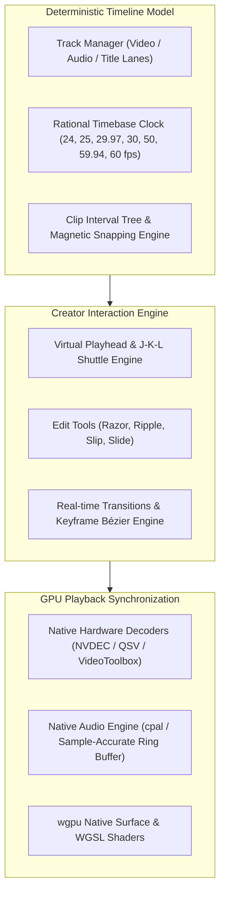

# 04. Timeline & Editing Workflows

## 1. Timeline Core Architecture

The StudioGrade NLE timeline is engineered to deliver the rapid, frictionless assembly experience favored by modern digital creators, while maintaining sub-frame temporal precision and non-destructive track architecture.



---

## 2. Temporal Representation & Precision

All timestamps, durations, cut points, and transition spans are stored as **Rational Numbers** using 64-bit integer fractions:

$$\text{Time} = \frac{\text{Frames}}{\text{Timebase Numerator} / \text{Timebase Denominator}}$$

For example, $23.976\ \text{fps}$ is represented strictly as:
$$\text{Timebase} = \left(\frac{24000}{1001}\right)$$

This mathematical approach completely prevents accumulation errors and audio desynchronization that plague floating-point timestamp engines over long timelines.

---

## 3. Editing Modes: Magnetic vs. Standard Overwrite

### 3.1 Magnetic Mode (Creator Optimized)
- **Automatic Gap Elimination**: When a clip is deleted or shortened, downstream clips on the primary storyline automatically ripple left, closing empty gaps.
- **Connected Clips & Secondary Lanes**: Titles, B-roll overlays, and sound effects attach to parent clips on the primary lane via anchored time offsets. Moving the primary clip moves all attached assets in unison.
- **Smart Drag & Drop**: Dragging new media between two existing clips automatically creates room, shifting trailing media without accidental overwrites.

### 3.2 Non-Magnetic / Standard Multi-Track Mode
- Traditional horizontal tracks with fixed positions.
- Clips remain exactly where placed.
- Overwrite edits replace underlying frames; lift edits leave black gaps.

---

## 4. Cutting & Trimming Tool Matrix

```
[Q] Ripple Trim Start ───► | [Playhead] | ◄─── [W] Ripple Trim End
[Ctrl+B] Split at Playhead ───►  ✂ Cuts Active Clip Instantly
```

| Tool / Action | Shortcut | Description |
| :--- | :--- | :--- |
| **Selection Tool** | `V` | Default move, select, and adjust clip boundaries. |
| **Razor / Cut** | `C` or `Ctrl + B` | Cuts active clip(s) under the playhead into two independent segments. |
| **Ripple Delete** | `Shift + Del` | Deletes selected clip and closes the timeline gap. |
| **Ripple Trim Head** | `Q` | Trims clip start to the current playhead position and ripples left. |
| **Ripple Trim Tail** | `W` | Trims clip end to the current playhead position and ripples left. |
| **Slip Tool** | `Y` | Shifts the underlying media start/end frames without altering the clip's position or duration on the timeline. |
| **Slide Tool** | `U` | Moves the clip left or right on the timeline while adjusting neighboring clip lengths to accommodate. |
| **J-K-L Shuttle** | `J`, `K`, `L` | `J`: Reverse ($1\times, 2\times, 4\times, 8\times$); `K`: Pause; `L`: Forward ($1\times, 2\times, 4\times, 8\times$). |

---

## 5. Transition & Effects Engine

### 5.1 Real-Time GPU Transition System
Transitions are represented as shader functions operating over overlapping temporal handles:

```
Track 1:  [       Clip A       ][Handle A]
Track 2:                 [Handle B][       Clip B       ]
                         ▲───────▲
                     Transition Overlap
```

- **Built-in Transition Library**:
  - *Smooth Motion*: Zoom In/Out, Whip Pan (Left/Right/Up/Down), Spin, Push, Slide.
  - *Optical & Dissolve*: Film Cross Dissolve, Dip to Color/Black/White, Non-Additive Dissolve.
  - *Stylized & Creative*: Glitch, RGB Split, Light Leak, Lens Flare, Film Burn, Page Curl.
- All transitions execute within native `wgpu` / WGSL fragment shaders with customizable duration, curve ease, and motion blur intensity.

### 5.2 Keyframing & Speed Ramping
- **Bézier Keyframe Editor**: Every transform parameter (Position $X/Y$, Scale, Rotation, Opacity, Anchor Point, Crop) supports keyframing with cubic Bézier ease in/out curve handles.
- **Optical Speed Ramping**:
  - Linear speed multipliers ($0.1\times$ slow-motion to $100\times$ hyperlapse).
  - Dynamic speed curves with smooth acceleration and deceleration points.
  - Integrated optical flow frame blending for artifact-free extreme slow motion.

---

## 6. Motion Titles & Graphic Templates

StudioGrade NLE provides a rich collection of modular vector-rendered title templates:
- **Kinetic Lower-Thirds**: Auto-resizing text badges with entry/exit animations.
- **Social Overlays**: Follow prompts, subscribe buttons, like badges, countdown clocks.
- **Smart Captions & Subtitles**: Whisper-based automatic speech-to-text generation directly creating timed subtitle track items with styling presets (TikTok/Reels pop-in, highlight active spoken word).

---

## 7. Media Pool & Asset Management

```
Media Pool Workspace
├── 📁 Raw Camera Footage (Color Space: Auto-Detected)
├── 📁 Audio & Sound Effects
│   ├── 🎵 Background Music (BPM tagged, beat grid enabled)
│   └── 🎙️ Voiceover Stems (Cleaned & leveled)
├── 📁 Motion Graphics & Overlays
└── 📁 Generated Proxies & Optimized Media
```

- **Smart Bins**: Dynamic search folders filtering assets by frame rate, camera model, resolution, codec, and user metadata tags.
- **Audio Waveform Auto-Sync**: Aligns multi-camera video clips and external high-fidelity audio tracks by analyzing and cross-correlating audio frequency waveforms.
