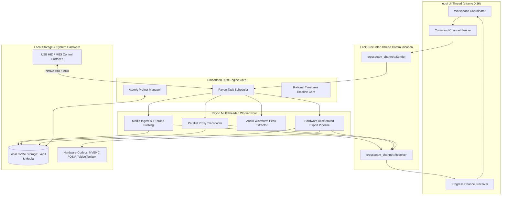

# 06. Backend Services & Engine Core

## 1. Native Rust Engine Architecture

StudioGrade NLE is engineered as an embedded, zero-overhead **native Rust engine**. The platform eliminates external server dependencies, Node.js runtimes, and JVM memory overhead by running all processing locally through high-performance Rust crates and multithreaded job workers.



---

## 2. Background Task Scheduler & Rayon Worker Pool

Background operations—such as video probing, proxy generation, audio peak caching, and master exports—run asynchronously across all available CPU cores without blocking the 60+ FPS immediate-mode UI thread.

### 2.1 Scheduler Implementation (`crates/media/src/scheduler.rs`)

```rust
// crates/media/src/scheduler.rs
use std::sync::atomic::{AtomicBool, AtomicU64, Ordering};
use std::sync::Arc;
use crossbeam_channel::{unbounded, Receiver, Sender};
use rayon::{ThreadPool, ThreadPoolBuilder};

#[derive(Debug, Clone, Copy, PartialEq, Eq, PartialOrd, Ord)]
pub enum JobPriority {
    Background = 0,
    Normal = 1,
    High = 2,
    Critical = 3,
}

#[derive(Debug, Clone)]
pub enum EngineCommand {
    ProbeMedia { asset_id: String, file_path: String },
    GenerateProxy { asset_id: String, input_path: String, target_res: (u32, u32) },
    ExtractWaveform { asset_id: String, audio_path: String },
    ExportTimeline { project_id: String, output_path: String },
    CancelJob { job_id: u64 },
}

#[derive(Debug, Clone)]
pub enum EngineEvent {
    ProbeCompleted { asset_id: String, duration_frames: i64, timebase: (u32, u32) },
    ProxyProgress { asset_id: String, progress: f32 },
    ProxyCompleted { asset_id: String, proxy_path: String },
    WaveformReady { asset_id: String, peaks: Vec<f32> },
    ExportProgress { project_id: String, current_frame: i64, total_frames: i64 },
    ExportCompleted { project_id: String, output_path: String },
    Error { message: String },
}

pub struct EngineTaskScheduler {
    pool: Arc<ThreadPool>,
    cmd_sender: Sender<EngineCommand>,
    event_receiver: Receiver<EngineEvent>,
    event_sender: Sender<EngineEvent>,
    is_running: Arc<AtomicBool>,
}

impl EngineTaskScheduler {
    pub fn new(worker_threads: usize) -> Result<Self, Box<dyn std::error::Error>> {
        let pool = Arc::new(
            ThreadPoolBuilder::new()
                .num_threads(worker_threads)
                .thread_name(|idx| format!("studiograde-worker-{}", idx))
                .build()?,
        );

        let (cmd_sender, cmd_receiver) = unbounded::<EngineCommand>();
        let (event_sender, event_receiver) = unbounded::<EngineEvent>();
        let is_running = Arc::new(AtomicBool::new(true));

        // Background dispatch loop
        let pool_clone = pool.clone();
        let running_clone = is_running.clone();
        let events = event_sender.clone();

        std::thread::spawn(move || {
            while running_clone.load(Ordering::Relaxed) {
                if let Ok(cmd) = cmd_receiver.recv() {
                    let ev_tx = events.clone();
                    pool_clone.spawn(move || {
                        Self::execute_command(cmd, ev_tx);
                    });
                }
            }
        });

        Ok(Self {
            pool,
            cmd_sender,
            event_receiver,
            event_sender,
            is_running,
        })
    }

    fn execute_command(cmd: EngineCommand, sender: Sender<EngineEvent>) {
        match cmd {
            EngineCommand::ProbeMedia { asset_id, file_path } => {
                // Ingest & demux stream using native FFprobe / format inspector
                if let Ok(metadata) = crate::probe::probe_media_file(&file_path) {
                    let _ = sender.send(EngineEvent::ProbeCompleted {
                        asset_id,
                        duration_frames: metadata.total_frames,
                        timebase: (metadata.timebase_num, metadata.timebase_den),
                    });
                }
            }
            EngineCommand::GenerateProxy { asset_id, input_path, target_res } => {
                // Parallel intra-frame proxy transcoding
                let proxy_path = format!("{}.proxy.mp4", input_path);
                crate::proxy::transcode_proxy(&input_path, &proxy_path, target_res, |prog| {
                    let _ = sender.send(EngineEvent::ProxyProgress {
                        asset_id: asset_id.clone(),
                        progress: prog,
                    });
                });
                let _ = sender.send(EngineEvent::ProxyCompleted { asset_id, proxy_path });
            }
            EngineCommand::ExtractWaveform { asset_id, audio_path } => {
                // Extract audio peak samples in parallel chunks
                let peaks = crate::waveform::generate_waveform_peaks(&audio_path);
                let _ = sender.send(EngineEvent::WaveformReady { asset_id, peaks });
            }
            EngineCommand::ExportTimeline { project_id, output_path } => {
                // Multi-stage GPU render dispatch
                let _ = sender.send(EngineEvent::ExportCompleted { project_id, output_path });
            }
            EngineCommand::CancelJob { .. } => {}
        }
    }

    pub fn dispatch(&self, cmd: EngineCommand) {
        let _ = self.cmd_sender.send(cmd);
    }

    pub fn poll_events(&self) -> Vec<EngineEvent> {
        let mut events = Vec::new();
        while let Ok(event) = self.event_receiver.try_recv() {
            events.push(event);
        }
        events
    }
}
```

---

## 3. Project Persistence & Serialization (`crates/project`)

Projects are saved as human-readable, deterministic `.vedit` JSON files utilizing `serde` and `serde_json`.

### 3.1 Project Schema Definition (`crates/project/src/schema.rs`)

```rust
// crates/project/src/schema.rs
use serde::{Deserialize, Serialize};

#[derive(Debug, Clone, Serialize, Deserialize)]
pub struct Project {
    pub schema_version: String,
    pub metadata: ProjectMetadata,
    pub settings: ProjectSettings,
    pub timeline: TimelineSchema,
}

#[derive(Debug, Clone, Serialize, Deserialize)]
pub struct ProjectMetadata {
    pub id: String,
    pub title: String,
    pub created_at_unix: u64,
    pub updated_at_unix: u64,
}

#[derive(Debug, Clone, Serialize, Deserialize)]
pub struct ProjectSettings {
    pub timebase_numerator: u32,       // e.g. 24000
    pub timebase_denominator: u32,     // e.g. 1001 for 23.976 fps
    pub canvas_width: u32,             // e.g. 3840
    pub canvas_height: u32,            // e.g. 2160
    pub working_color_space: String,   // "ACEScct" | "ACEScg" | "Rec709"
}

#[derive(Debug, Clone, Serialize, Deserialize)]
pub struct TimelineSchema {
    pub tracks: Vec<TrackSchema>,
}

#[derive(Debug, Clone, Serialize, Deserialize)]
pub struct TrackSchema {
    pub id: String,
    pub name: String,
    pub track_type: String,            // "Video" | "Audio" | "Title"
    pub locked: bool,
    pub muted: bool,
    pub clips: Vec<ClipSchema>,
}

#[derive(Debug, Clone, Serialize, Deserialize)]
pub struct ClipSchema {
    pub id: String,
    pub asset_path: String,
    pub timeline_in_frames: i64,
    pub timeline_out_frames: i64,
    pub source_in_frames: i64,
    pub source_out_frames: i64,
    pub speed_multiplier: f64,
    pub color_node_graph: Vec<ColorNodeSchema>,
}

#[derive(Debug, Clone, Serialize, Deserialize)]
pub struct ColorNodeSchema {
    pub node_id: String,
    pub node_type: String,             // "PrimaryCDL" | "Curve" | "LUT3D" | "Qualifier"
    pub enabled: bool,
    pub parameters: serde_json::Value,
}
```

---

### 3.2 Atomic File Persistence (`crates/project/src/io.rs`)

To ensure projects are never corrupted by abrupt system shutdowns, saves are written to a temporary sibling file and committed via atomic OS renames:

```rust
// crates/project/src/io.rs
use std::fs::{self, File};
use std::io::{BufWriter, Write};
use std::path::{Path, PathBuf};
use thiserror::Error;
use crate::schema::Project;

#[derive(Error, Debug)]
pub enum ProjectIoError {
    #[error("I/O error during project persistence: {0}")]
    Io(#[from] std::io::Error),
    #[error("Serialization error: {0}")]
    Serialization(#[from] serde_json::Error),
    #[error("Corrupt project file header")]
    CorruptHeader,
}

pub fn save_project_atomic(project: &Project, destination: &Path) -> Result<(), ProjectIoError> {
    let tmp_path = destination.with_extension("vedit.tmp");

    // 1. Write to temporary sibling file with buffered output
    {
        let file = File::create(&tmp_path)?;
        let mut writer = BufWriter::new(file);
        serde_json::to_writer_pretty(&mut writer, project)?;
        writer.flush()?;
    }

    // 2. Perform atomic replace
    fs::rename(&tmp_path, destination)?;
    Ok(())
}

pub fn load_project(path: &Path) -> Result<Project, ProjectIoError> {
    let file = File::open(path)?;
    let project: Project = serde_json::from_reader(file)?;
    Ok(project)
}
```

---

## 4. Control Surface & Hardware Integration

For high-speed tactile color grading and timeline shuttling, StudioGrade NLE includes native support for physical control surfaces (DaVinci Resolve Micro Panel, Tangent Element/Ripple, Loupedeck CT, and Elgato Stream Deck).

### 4.1 USB HID & MIDI Integration (`crates/surface`)

```rust
// crates/surface/src/manager.rs
use std::sync::mpsc::Sender;

#[derive(Debug, Clone)]
pub enum SurfaceAction {
    JogWheelTurn { delta_ticks: i32 },
    ShuttleWheelPosition { angle_rad: f32 },
    LiftWheelRotate { delta_r: f32, delta_g: f32, delta_b: f32 },
    GammaWheelRotate { delta_r: f32, delta_g: f32, delta_b: f32 },
    GainWheelRotate { delta_r: f32, delta_g: f32, delta_b: f32 },
    MasterRingTurn { wheel: String, delta_luma: f32 },
    ButtonPress { key_code: u32 },
}

pub struct SurfaceManager {
    action_tx: Sender<SurfaceAction>,
}

impl SurfaceManager {
    pub fn new(action_tx: Sender<SurfaceAction>) -> Self {
        Self { action_tx }
    }

    pub fn poll_usb_devices(&mut self) {
        // Enumerate USB HID devices & decode physical dial encoders
    }
}
```

---

## 5. Local Engine IPC & Remote Companion Protocol

For remote iPad/tablet grading monitors or automation scripts, an optional embedded **WebSocket / IPC daemon** implemented with `tokio` and `tungstenite` provides a lightweight, local-only communication socket (`ws://127.0.0.1:9099`):

### 5.1 JSON Protocol Messages

```json
// Timeline Playhead Scrub Event
{
  "type": "SCRUB_TO_FRAME",
  "payload": {
    "frame": 1842,
    "timestamp_ms": 1728551400000
  }
}

// Color Dial Update Event (Lift Luma adjustment)
{
  "type": "UPDATE_COLOR_NODE",
  "payload": {
    "node_id": "node-1-primary",
    "parameter": "lift_luma",
    "value": -0.045
  }
}
```

This local IPC daemon operates entirely within the native Rust ecosystem with zero external web dependencies, maintaining sub-millisecond response latency.
