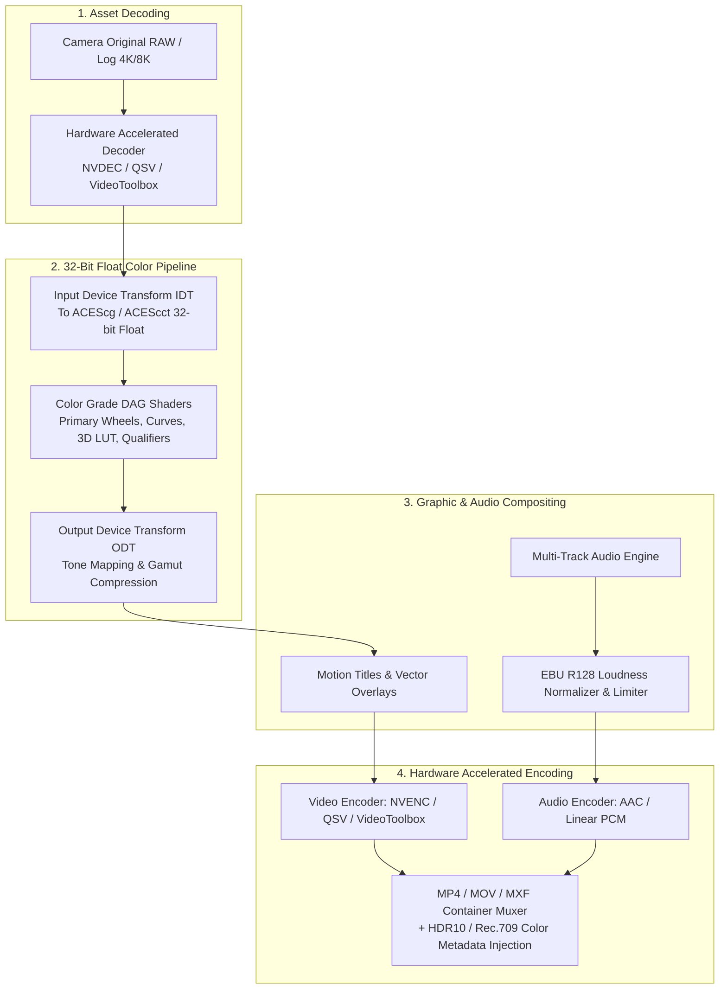

# 07. Export & Rendering Pipeline

## 1. High-Precision Render Architecture

Exporting in StudioGrade NLE is managed through a deterministic, multi-stage render graph. Unlike consumer applications that encode directly from 8-bit screen buffers, our render core pulls pristine **Camera Original Media (RAW/Log)**, executes the entire color grading node DAG in **32-bit linear floating point**, applies the calibrated Output Device Transform (ODT), and encodes to the target broadcast format with complete metadata tags.



---

## 2. Color Space & HDR Metadata Injection

For high-accuracy color display on calibrated consumer monitors and HDR TVs, the encoder embeds precise NCLX and mastering display metadata:

### 2.1 Broadcast Standard Color Tags

| Target Format | `-color_primaries` | `-color_trc` | `-colorspace` | `-color_range` |
| :--- | :--- | :--- | :--- | :--- |
| **SDR Web & YouTube** | `bt709` | `bt709` (or `iec61966-2-1`) | `bt709` | `tv` (Limited 16-235) |
| **SDR Broadcast TV** | `bt709` | `bt709` (Gamma 2.4) | `bt709` | `tv` (16-235) |
| **Cinema DCI-P3** | `smpte432` | `smpte431` (Gamma 2.6) | `bt709` | `full` (0-255 / 0-1023) |
| **HDR10 (PQ)** | `bt2020` | `smpte2084` | `bt2020nc` | `tv` (64-940 in 10-bit) |
| **HLG (Hybrid Log Gamma)** | `bt2020` | `arib-std-b67` | `bt2020nc` | `tv` (64-940 in 10-bit) |

### 2.2 HDR10 Static Metadata Flags
When mastering HDR10 projects, the render orchestrator injects SMPTE ST 2086 mastering display data and MaxCLL/MaxFALL flags:

```bash
ffmpeg -i input_graded_raw.yuv \
  -c:v hevc_nvenc -preset p7 -profile:v main10 -pix_fmt p010le -b:v 45M \
  -color_primaries bt2020 -color_trc smpte2084 -colorspace bt2020nc -color_range tv \
  -master-display "G(13250,34500)B(7500,3000)R(34000,16000)WP(15635,16450)L(10000000,50)" \
  -max-cll "1000,400" \
  -c:a aac -b:a 320k \
  output_hdr10_master.mp4
```

---

## 3. Hardware Encoder Acceleration Matrix

The native render worker dynamically interrogates available host GPU architecture:

1. **NVIDIA NVENC (Ampere / Ada Lovelace / Blackwell)**:
   - High-performance 10-bit HEVC (`hevc_nvenc`) and AV1 (`av1_nvenc`) encoding.
   - Dual-encoder NVENC splitting for export speeds up to $4\times$ real-time on 4K 60fps footage.
2. **Apple Silicon VideoToolbox (M-Series Pro / Max / Ultra)**:
   - Dedicated hardware ProRes 422 HQ / 4444 engines.
   - Low-power HEVC 10-bit encoding (`hevc_videotoolbox`).
3. **Intel QuickSync Video (Arc / Core Ultra)**:
   - DeepLink multi-GPU encoding (`hevc_qsv`, `av1_qsv`).
4. **AMD AMF (RDNA 3 / RDNA 4)**:
   - Accelerated HEVC and AV1 mastering.

---

## 4. Audio Mastering & Loudness Normalization

The audio export pipeline runs compliant **EBU R128 / ITU-R BS.1770-4** loudness processing:

$$\text{Integrated Loudness Target} = -14.0\ \text{LUFS (Streaming)} \quad \text{or} \quad -23.0\ \text{LUFS (EBU Broadcast)}$$
$$\text{Maximum True Peak} = -1.0\ \text{dBTP}$$

### FFmpeg Loudness Normalization Filter Pass
```bash
ffmpeg -i render_mixdown.wav \
  -af loudnorm=I=-14:LRA=7:TP=-1.0:measured_I=-18.2:measured_LRA=8.5:measured_TP=-0.4 \
  -c:a aac -b:a 320k mastered_audio.m4a
```

---

## 5. Standard Export Preset Catalog

```
┌────────────────────────────────────────────────────────┐
│ Export Dialog                                          │
├────────────────────────────────────────────────────────┤
│ Presets:                                               │
│ [●] YouTube 4K HDR (HEVC / BT.2020 PQ / 60 Mbps)      │
│ [ ] TikTok / Reels Vertical (1080x1920 / 60fps / H.264)│
│ [ ] Cinema Master (Apple ProRes 422 HQ / Rec.709)      │
│ [ ] Broadcast Clean (Avid DNxHR HQX 10-bit / EBU R128) │
│ [ ] Web Optimized (AV1 / 1080p / 8 Mbps)               │
├────────────────────────────────────────────────────────┤
│ Estimated Size: 1.42 GB • Est. Time: 01m 24s           │
│ [ Cancel ]                                [ Export Now ]│
└────────────────────────────────────────────────────────┘
```

- **YouTube 4K 60fps HDR**: Resolution $3840 \times 2160$, 10-bit HEVC/AV1, BT.2020 PQ, Target Bitrate $60\ \text{Mbps}$, Stereo $320\ \text{kbps}$ AAC, $-14\ \text{LUFS}$.
- **Social Vertical (Reels / TikTok / Shorts)**: Resolution $1080 \times 1920$, H.264 High Profile, Rec.709, Target Bitrate $18\ \text{Mbps}$, $-14\ \text{LUFS}$.
- **ProRes Cinema Master**: Resolution Source-Matching, Apple ProRes 422 HQ / 4444 XQ, 10-bit / 12-bit, Uncompressed 24-bit 48kHz PCM Audio.
- **VFX Intermediate**: 16-bit half-float OpenEXR frame sequence with embedded ACEScg chromaticity data.
