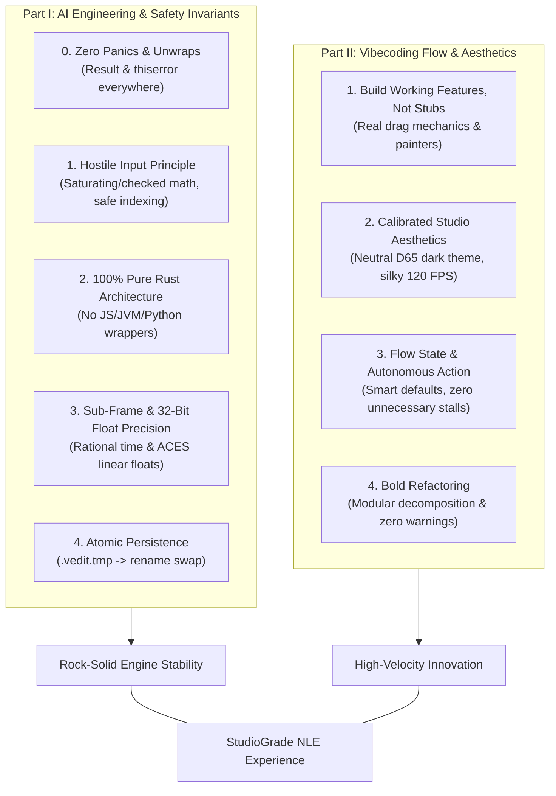

# 08. AI Engineering & Vibecoding Rules

## 1. Overview & Philosophy

StudioGrade NLE combines industrial-grade software reliability with the speed and creative agility of **vibecoding**. This document specifies the operational principles, engineering invariants, and flow-state workflows that every human and AI contributor must follow.



---

## 2. Part I: AI Engineering Rules (Safety & Invariants)

### 2.1 Never Crash (Zero-Panic Policy)
Video creators trust StudioGrade NLE with hours of creative work. A malformed media header, a corrupt JSON tag, an illegal timeline cut, or an unexpected keystroke must **never crash the application**.

1. **`Result<T, E>` Propagation**: Return the crate's dedicated error type and propagate failures using `?`. Context must never be discarded:
   ```rust
   // CORRECT
   pub fn load_project_file(path: &Path) -> Result<Project, ProjectError> {
       let file = File::open(path).map_err(|e| ProjectError::Io(path.to_path_buf(), e))?;
       let project = serde_json::from_reader(file)?;
       Ok(project)
   }
   ```
2. **Prohibited Panic Primitives**: The following macros and methods are forbidden in production crates:
   - `unwrap()`
   - `expect()`
   - `panic!()`
   - `todo!()`
   - `unimplemented!()`
   - `unreachable!()`
   Instead, use `?`, `ok_or()`, `let Some(x) = ... else { return ... }`, or explicit graceful fallbacks.
3. **Hostile Input Verification**:
   - Array and slice access must use `.get(index)` or be preceded by an explicit bounds check.
   - All arithmetic on timestamps, frame counts, sample rates, and coordinate dimensions must use `checked_*` or `saturating_*` functions (`checked_add`, `saturating_sub`).
   - Slicing strings must only occur on valid UTF-8 character boundaries.
   - Never divide by a value that can be zero (e.g., aspect ratios, frame rates, zoom factors).
4. **Worker Thread Isolation**:
   - All background jobs (frame decoders, proxy generators, waveform peak analyzers, export pipelines) must run under `std::panic::catch_unwind`.
   - If a background worker encounters an unrecoverable failure, it sends an `EngineEvent::Error` across the channel so the UI thread can notify the user without halting the session.

### 2.2 Pure Rust & Architecture Layering
- The entire project is 100% native Rust (`eframe`, `egui`, `wgpu`, `rayon`, `serde`, `rfd`).
- Core engine crates (`timeline`, `color`, `audio`, `project`, `media`, `render`, `export`) must never depend on the UI crates (`egui`, `eframe`).
- Crate dependencies flow strictly downward: UI $\rightarrow$ Engine Orchestrator $\rightarrow$ Pure Logic Crates $\rightarrow$ Low-level Utilities.

### 2.3 Mathematical Precision & Color Science
- **Rational Timebase**: All timestamps, durations, in/out edit points, and playback clocks must strictly use 64-bit rational numbers (`RationalTime { frames: i64, timebase: (u32, u32) }`). Floating-point seconds are never used for editing operations.
- **Unclipped Floating Point Color**: All internal pixel manipulation, color grading math, and 3D LUT lookups run in IEEE 754 32-bit linear float space (`ACEScct`/`ACEScg`), preventing highlight clipping and posterization.

### 2.4 Atomic Project Persistence
- Project files (`.vedit`) must be serialized via `serde_json` to a temporary sibling file (`.vedit.tmp`), flushed to disk, and committed using an atomic file rename (`std::fs::rename`).
- This guarantees that power interruptions or sudden process termination never leave a corrupted project file on disk.

---

## 3. Part II: Vibecoding Rules (Velocity & Aesthetics)

Vibecoding is centered on maintaining creative velocity, eliminating friction, and producing software that feels immediately alive, tactile, and visually captivating.

### 3.1 Build Working Features, Not Empty Stubs
- **Zero Placeholder Code**: When creating a component, implement the actual interactive state machine, event handlers, and rendering logic immediately.
- **Immediate Playability**: Ensure every new widget or control can be clicked, scrubbed, or dragged from the moment it is introduced.

### 3.2 Calibrated Studio Aesthetics (Wow Factor)
- **Neutral D65 Dark Palette**: All interface backgrounds, panel borders, and widget fills must adhere strictly to calibrated neutral dark tones (`StudioColors`) so they do not distort color perception.
- **Tactile Micro-Interactions**: Sliders, dials, and scrub heads must feature smooth hover highlights, crisp active borders, and responsive feedback at 60–144 FPS.
- **Clean Typography & Layout**: Spacing, padding, and alignments must be balanced and intentional.

### 3.3 Flow State & Autonomous Velocity
- **Smart Defaults Over Interruption**: Make confident, idiomatic engineering decisions without interrupting the user for routine choices.
- **Root-Cause Engineering**: Address architectural bottlenecks and bugs at their core rather than patching symptoms.
- **Fearless Refactoring**: As new features evolve, refactor modules boldly into clean structs, traits, and separated concerns.
- **Zero Warnings Policy**: Ensure every file compiles cleanly with no compiler warnings or dead imports.

---

## 4. Operational Checklist for Contributors

Before committing any feature or refactoring:

| Check | Requirement | Verification |
| :--- | :--- | :--- |
| **Zero Panics** | No `unwrap()` / `expect()` in production code. | `cargo clippy --workspace -- -D clippy::unwrap_used` |
| **Pure Rust** | No foreign-language runtimes or wrappers. | Verified in `Cargo.toml` dependency tree. |
| **Aesthetic Polish** | Uses `StudioColors` neutral D65 theme tokens. | Inspect `egui` visuals and widget styling. |
| **Exact Time** | Uses `RationalTime`, not `f64` seconds. | Review timeline math types. |
| **Atomic Saves** | Project persistence writes to `.tmp` before renaming. | Review `crates/project/src/io.rs`. |
| **Clean Build** | Workspace compiles with zero errors and warnings. | `cargo check --workspace` |
