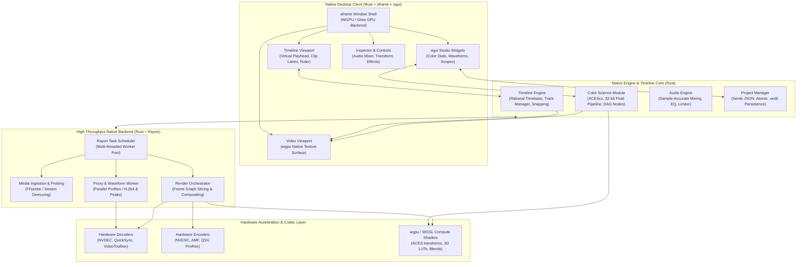

# StudioGrade NLE & Precision Color Suite Documentation

Welcome to the official technical documentation for **StudioGrade NLE**, a modern high-performance desktop video editing and color mastering suite built entirely in **Rust**. The suite merges the approachable, intuitive creator-focused workflow of modern timeline editors with the uncompromising, mathematical 32-bit floating-point color science of studio mastering suites—engineered with zero-cost abstractions, fearless multithreading, and direct GPU acceleration.

---

## 📚 Documentation Index

| Document | Description |
| :--- | :--- |
| **[01. System Overview](./01-system-overview.md)** | Product vision, architectural goals, core philosophies, target user personas, and high-level platform topography. |
| **[02. Architecture & Tech Stack](./02-architecture-and-tech-stack.md)** | Comprehensive breakdown of the unified Rust architecture, Cargo workspace crates, `eframe`/`egui` native UI, Rayon multithreaded processing, and native rendering core. |
| **[03. Color Grading Engine](./03-color-grading-engine.md)** | 32-bit floating-point color science, ACES/OCIO pipelines, Primary Lift/Gamma/Gain, HDR Zone wheels, 3D LUT math, node-based DAG grading graphs, and GPU broadcast scopes. |
| **[04. Timeline & Editing Workflows](./04-timeline-and-editing-workflows.md)** | Multi-track timeline engine, magnetic snapping, ripple trimming, keyframe Bézier curves, transition generators, motion presets, and asset management. |
| **[05. Frontend UI/UX Design System](./05-frontend-ui-ux-design-system.md)** | Dark-themed studio design system built with `egui` and `eframe`, custom studio widgets, dockable panels, inspector controls, and interactive color dials. |
| **[06. Backend Services & Engine Core](./06-backend-services-and-api.md)** | Native Rust engine core, Rayon background job pool, media ingestion, proxy pipeline, project serialization schema (`.vedit`), and control surface integration. |
| **[07. Export & Rendering Pipeline](./07-export-and-rendering-pipeline.md)** | Multi-pass export graph, hardware encoder acceleration (NVENC, QuickSync, Apple VideoToolbox), broadcast color tagging, and EBU R128 audio mastering. |
| **[08. AI & Vibecoding Rules](./08-ai-and-vibecoding-rules.md)** | Engineering invariants, zero-panic policy, hostile input handling, aesthetic standards, and high-velocity vibecoding principles. |

---

## 🏛️ Platform Architecture At a Glance

---

## 🎯 Core Engineering Principles

1. **Sub-Frame Accuracy**: Timeline operations, audio synchronizations, and keyframe interpolations operate on 64-bit rational timebases (`frames / timebase`) with zero floating-point accumulation drift.
2. **Hollywood-Grade Color Fidelity**: Every color operation occurs in linear 32-bit float space. Highlights roll off smoothly without clipping, and color transforms adhere to strict ACES 1.3 / OpenColorIO standards.
3. **Pure-Rust Zero-Cost Performance**: Eliminates JavaScript garbage collection pauses and JVM memory bloat. The entire client and processing core run in native Rust with deterministic memory allocation and SIMD/Rayon parallelism.
4. **Immediate-Mode Studio Ergonomics**: Built on `egui` and `eframe` for sub-millisecond layout passes, instant 120+ FPS UI responsiveness, and a distraction-free studio neutral dark theme.
5. **Robust System Durability**: Strong type safety, exhaustive error handling via `thiserror`, and atomic disk serialization via `serde`/`serde_json` prevent project corruption under any circumstance.
